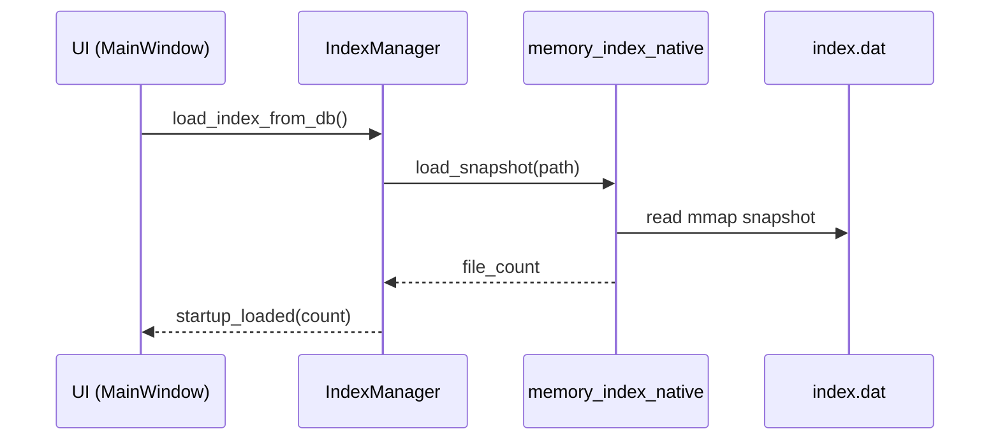
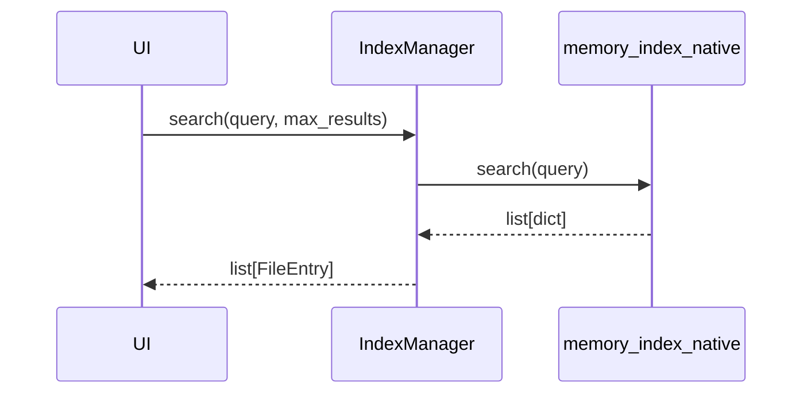

# ValkyrieFS 아키텍처 & 프로젝트 구조

> 목적: ValkyrieFS의 **런타임 아키텍처**, **디렉토리 구조**, **데이터 흐름**, **배포/권한 모델**을 한 문서에서 빠르게 이해할 수 있게 정리합니다.

---

## 목차

- [한 줄 요약](#한-줄-요약)
- [핵심 목표 / 비목표](#핵심-목표--비목표)
- [런타임 구성(현재)](#런타임-구성현재)
- [디렉토리 구조](#디렉토리-구조)
- [인덱싱(스캔) 흐름](#인덱싱스캔-흐름)
- [검색 흐름](#검색-흐름)
- [Everything 방식 참고(MFT + USN)](#everything-방식-참고mft--usn)
- [권한/서비스 모델(Everything 스타일)](#권한서비스-모델everything-스타일)
- [다중 드라이브(멀티 볼륨) 지원 메모](#다중-드라이브멀티-볼륨-지원-메모)
- [영속화(스냅샷)](#영속화스냅샷)
- [빌드/패키징 파이프라인](#빌드패키징-파이프라인)
- [확장 포인트](#확장-포인트)
- [관련 문서](#관련-문서)
- [용어](#용어)

---

## 한 줄 요약

ValkyrieFS는 **NTFS 메타데이터(USN/MFT) 기반 스캐너 + C++ 메모리 인덱스 + 스냅샷(`index.dat`)** 조합으로, Everything처럼 “이름 기반” 초고속 검색을 목표로 합니다.

---

## 핵심 목표 / 비목표

### 핵심 목표

- **빠른 초기 로드**: 이전 인덱스를 스냅샷에서 빠르게 복원
- **빠른 검색 응답**: 검색은 C++ 메모리 인덱스에서 수행(필요한 결과만 Python 객체로 변환)
- **UI 반응성**: 인덱싱/검색은 백그라운드에서 실행(디바운스/스레드 풀)
- **Everything 스타일 권한 모델 지향**: 설치 시 권한 승인 후, UI는 일반 권한으로 실행

### 비목표(현재)

- 파일 “내용” 검색(Full-text)
- 모든 파일시스템/네트워크 드라이브에서 Everything 수준 성능 보장
- 완전한 “증분 업데이트”(현재는 스캔 시 리빌드 성격이 강함)

---

## 런타임 구성(현재)

### 컴포넌트 맵

- **UI (PySide6)**: `src/ui/*`
  - 입력/결과 렌더링, 디바운스, 키보드 중심 UX
- **IndexManager (Python 오케스트레이션)**: `src/core/index_manager.py`
  - 스캐너 선택, 스캔 실행, 메모리 인덱스 빌드/저장/로드
- **FileSystemScanner (스캔 전략)**: `src/core/filesystem/*`
  - USN 기반(네이티브/ctypes), (레거시) walk 기반 등
- **C++ Memory Index (검색/스냅샷)**: `memory_index_native` (native 모듈)
  - 파일 메타데이터 저장/검색, `index.dat` 스냅샷 로드/세이브

### 전체 그림(개념)

```mermaid
flowchart LR
  UI[PySide6 UI<br/>src/ui] -->|search(query)| IM[IndexManager<br/>src/core/index_manager.py]
  UI -->|start scan| IM

  IM -->|scan_directory(root)| SCN[Scanner Strategy<br/>src/core/filesystem/*]
  SCN -->|file dict list| IM

  IM -->|add/build/search| CXX[C++ Memory Index<br/>memory_index_native]
  CXX <--> SNAP[index.dat<br/>~/.valkyrie/index.dat]
```

---

## 디렉토리 구조

### 최상위

| 경로 | 역할 |
|---|---|
| `src/` | 앱 코드(Python) |
| `native/` | C/C++ 네이티브 모듈(USN 스캔, 메모리 인덱스) |
| `service/` | Windows Service(C#) 관련(권한/백그라운드 모델용) |
| `installer/` | Inno Setup 스크립트/설치기 구성 |
| `docs/` | 문서(이 파일 포함) |

### `src/` 내부(핵심)

| 경로 | 역할 |
|---|---|
| `src/main.py` | 앱 엔트리포인트(아이콘/AppUserModelID/스플래시/부트스트랩) |
| `src/ui/` | UI(메인 창, 리스트 모델/델리게이트, 스타일, 스플래시) |
| `src/core/` | 인덱싱/검색 오케스트레이션(스캐너 선택, 스냅샷 로드/세이브) |
| `src/core/filesystem/` | 스캐너 구현(USN 기반 등) |
| `src/core/memory_index_manager.py` | `memory_index_native` 래퍼(스냅샷 포함) |
| `src/models/` | 데이터 모델(`FileEntry`) |
| `src/utils/` | 런타임 경로/리소스 로더 등 유틸 |

> 참고: `src/db/`는 SQLite 기반 레거시/참고 구현이 남아있을 수 있으나, 현재 주요 경로는 **스냅샷(`index.dat`) 기반**입니다.

---

## 인덱싱(스캔) 흐름

### 앱 시작 시(빠른 시작)

1. UI가 시작되면 `IndexManager.load_index_from_db()`(명칭은 레거시)로 **스냅샷 로드**를 시도합니다.
2. `~/.valkyrie/index.dat`가 있으면 빠르게 복원되어 즉시 검색 가능 상태가 됩니다.



### 스캔 실행(현재 구현 특징)

- `scan_directory(root)`는 스캐너가 반환한 파일 목록을 받아 **메모리 인덱스를 clear → add → build → save_snapshot** 형태로 구성합니다.  
  (즉 “증분 업데이트”가 아니라, 현재 단계에서는 **리빌드** 성격이 강합니다.)

```mermaid
flowchart TB
  A[scan_directory(root)] --> B[scanner.scan_directory(root)]
  B --> C[file_list (dict list)]
  C --> D[memory_index.clear()]
  D --> E[memory_index.add_files(file_list)]
  E --> F[memory_index.build()]
  F --> G[memory_index.save_snapshot()]
```

---

## 검색 흐름

- UI는 입력(디바운스)마다 `IndexManager.search(query)`를 요청합니다.
- `IndexManager`는 C++ 메모리 인덱스에서 결과를 받아, UI에 필요한 만큼만 `FileEntry`로 변환합니다.



---

## Everything 방식 참고(MFT + USN)

Everything이 빠른 이유는 “폴더 순회” 대신 **NTFS 메타데이터**를 활용하기 때문입니다.

- **초기 인덱싱**: NTFS **MFT(Master File Table)**를 열거해 파일 목록을 빠르게 구성
  - 대표적으로 `FSCTL_ENUM_USN_DATA` + `DeviceIoControl` 조합이 사용됩니다.
- **실시간 반영(증분)**: **USN Change Journal**(변경 로그)로 생성/삭제/이동/이름변경 이벤트만 반영
  - 전체 재스캔 빈도를 낮춰 “항상 최신 + 낮은 리소스 사용”을 달성합니다.

---

## 권한/서비스 모델(Everything 스타일)

Everything은 권한 문제를 해결하기 위해 **서비스(권한 보유) + UI(일반 권한)** 모델을 제공합니다.
ValkyrieFS도 같은 방향의 아키텍처를 지향합니다.

- **UI(일반 권한)**: 검색/렌더링 중심
- **Service(권한 보유)**: 인덱싱/USN 모니터링/스냅샷 갱신 담당
- **IPC**: Named Pipe 또는 127.0.0.1 로컬 통신이 일반적

자세한 제안은 `SERVICE_MODEL.md`를 참고하세요.

---

## 다중 드라이브(멀티 볼륨) 지원 메모

현재 스캔은 “기본(홈 주요 폴더)”과 “entire(홈 드라이브 루트 또는 홈 전체)” 성격이 강해,
사용자가 파일을 **D:\\** 등에 많이 두면 누락될 수 있습니다.

권장 확장 방향(요약):

- **사용자 선택형(권장)**: 인덱싱 대상 드라이브/폴더를 UI/설정에서 선택
- **자동 탐지형**: 고정 드라이브(Fixed)만 열거해 USN 가능 볼륨을 대상으로 스캔(성능/권한/호환성 리스크 동반)

리스크:

- 초기 인덱싱 시간/메모리 폭증
- 권한/접근 실패(볼륨마다 상이)
- 파일시스템/네트워크 드라이브 폴백 정책 필요
- 서비스 컨텍스트에서 사용자 매핑 드라이브가 안 보일 수 있음

---

## 영속화(스냅샷)

- 기본 스냅샷 경로: `~/.valkyrie/index.dat`
- 목적: 앱 재실행 시 **빠른 로드**(Everything 스타일)
- 구현: `src/core/memory_index_manager.py`가 `memory_index_native`의 스냅샷 API를 래핑

---

## 빌드/패키징 파이프라인

### 산출물

- **앱(UI)**: PyInstaller `onedir` → `dist/ValkyrieFS/ValkyrieFS.exe`
- **서비스(C#)**: `dotnet publish` → `service/.../publish/*`
- **설치기**: Inno Setup → `installer/Output/ValkyrieFS-Setup.exe`

자세한 명령/아이콘/SmartScreen 메모는 `PACKAGING_GUIDE.md`를 참고하세요.

---

## 확장 포인트

- **스캐너 추가**: `src/core/filesystem/`에 `FileSystemScanner` 구현체 추가 후, `IndexManager`에서 선택/주입
- **권한 모델 고도화**: 서비스가 인덱스를 유지하고 UI는 IPC로 검색하도록 분리(`SERVICE_MODEL.md`)
- **멀티 드라이브 UX**: “인덱싱 대상 선택” 화면/설정 추가(리스크와 함께 설계 필요)

---

## 관련 문서

- `README.md`: 사용자용 개요/다운로드
- `PACKAGING_GUIDE.md`: PyInstaller/Inno Setup/아이콘/SmartScreen
- `SERVICE_MODEL.md`: Everything 스타일 권한 모델 제안
- `PERMISSIONS_AND_FALLBACK.md`: 권한/폴백 전략 메모
- `TECH_STACK.md`: 기술 스택/스냅샷 기반 영속화 개요
- `PROJECT_STRUCTURE.md`: 디렉토리 구조(상세)

---

## 용어

- **MFT (Master File Table)**: NTFS의 파일/폴더 메타데이터 테이블
- **USN Change Journal**: NTFS의 변경 로그(파일 생성/삭제/이동/이름변경 등 기록)
- **Snapshot (`index.dat`)**: 메모리 인덱스를 디스크에 저장한 바이너리 스냅샷(재시작 시 빠른 로드용)

